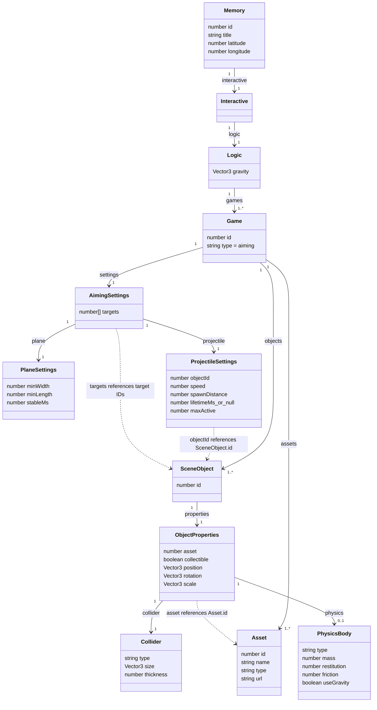
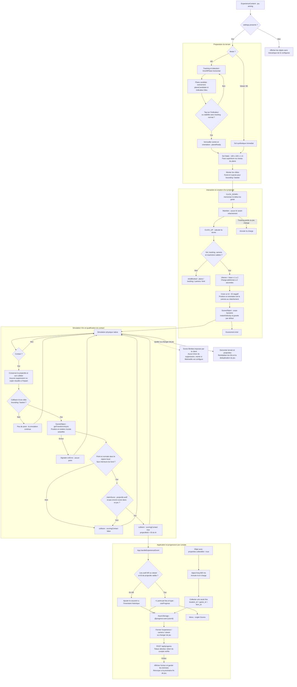

# Jeux d'adresse : API, JSON et fonctionnement interne

Cette documentation decrit le fonctionnement actuellement implemente dans
l'application mobile, pour un jeu `type: "aiming"` disposant de `settings`.
Sans `settings`, le template affiche simplement les objets : il ne prepare pas
le sol et ne gere pas les lancers configures.

Les blocs `mermaid` peuvent etre affiches avec un visualiseur Mermaid compatible.
Les donnees et identifiants des exemples sont fictifs.

## 1. Requetes API et preparation des ressources

```mermaid
sequenceDiagram
    actor User as Utilisateur
    participant App as Application mobile
    participant Auth as Service auth
    participant Store as AsyncStorage
    participant Radar as useRadar
    participant API as API Echoes
    participant Parser as readExperience
    participant Cache as Cache fichiers local
    participant AR as Scene AR / viewer 3D

    opt Connexion utilisateur
        User->>App: Se connecter
        App->>Auth: login(credentials)
        Auth->>API: POST /api/login (JSON)
        API-->>Auth: token ou access_token, user ou data
        Auth->>Store: Conserver token et utilisateur
    end

    App->>Radar: Obtenir une position GPS et charger les lieux
    Radar->>Auth: getAuthToken()
    Auth->>Store: Lire le token local
    Store-->>Radar: Token si disponible
    Radar->>API: GET /api/memories-near-me?latitude=LAT&longitude=LNG
    Note over Radar,API: Accept: application/json ; Authorization si token disponible
    alt Erreur HTTP
        API-->>Radar: Statut non 2xx
        Radar-->>App: Erreur API
    else Reponse valide
        API-->>Radar: Tableau JSON ou enveloppe data / memories
        Radar->>Radar: Normaliser les lieux et interactive.logic.games
        Radar-->>App: Memoires disponibles sur la carte / en AR
    end

    User->>App: Choisir une memoire interactive
    App->>Radar: cacheMemoryAssets(memory)
    Radar->>Parser: Valider jeux, assets, objets et settings
    alt Definition invalide
        Parser-->>App: Erreur explicite de preparation
    else Definition valide
        loop Chaque asset du jeu
            Radar->>Cache: Le fichier est-il deja disponible ?
            alt Fichier absent
                Radar->>API: GET URL de l'asset / api/private-files/...
                Note over Radar,API: Authorization si token disponible
                API-->>Cache: Fichier GLB, GLTF, OBJ ou autre media
            end
            Cache-->>Radar: URI locale file://...
        end
        Radar-->>App: Experience avec URL des assets mises en cache
        App->>AR: ExperienceContent puis ConfiguredAimingTemplate
    end
```

### Requetes utilisees par le client

Base API : `https://echoes.sophiehorner.art`.

| Usage | Methode et chemin | Donnees / resultat |
| --- | --- | --- |
| Connexion facultative | `POST /api/login` | Credentials JSON ; retourne un token et l'utilisateur. |
| Decouverte des lieux | `GET /api/memories-near-me?latitude={lat}&longitude={lng}` | Retourne les memoires et leurs definitions interactives. |
| Telechargement des assets | `GET {asset.url}` | URL distante resolue par le client ; contenu mis en cache localement. |
| Fichiers prives | `GET /api/private-files/{userId}/model_3D/{filename}` | Forme construite pour les references 3D privees ; une URL deja complete peut aussi etre utilisee. |
| Progression utilisateur | `POST /api/progress` | Bearer token ; totaux absolus des scores, lieux visites et objets collectes, a la fermeture ou au changement de jeu. |

Les requetes de lecture utilisent le token stocke lorsqu'il existe. Les URL
externes d'assets restent possibles : tous les telechargements ne visent donc pas
necessairement le serveur Echoes.

Le chargement accepte les enveloppes suivantes :

```json
{ "data": [] }
```

```json
{ "memories": [] }
```

Un tableau directement a la racine est egalement accepte. La normalisation
accepte plusieurs variantes des definitions interactives, dont certains champs
serialises en chaines JSON. L'exemple ci-dessous utilise des objets JSON natifs.
Les memoires sont dedupliquees par ID avant d'alimenter la carte et les marqueurs
AR : `1` et `"1"` designent la meme memoire. La premiere occurrence valide est
conservee et les IDs repetes sont signales par un avertissement dans les logs.
Deux lieux avec des IDs distincts restent distincts, meme aux memes coordonnees.
Les telechargements paralleles attendent une creation partagee du dossier de
cache, notamment au premier lancement. Une erreur reelle de creation est propagee
a la preparation AR ; elle n'est pas masquee. Le cache des modeles utilise le meme
mecanisme pour son propre dossier.

Les impacts individuels ne sont pas envoyes. Les totaux locaux sont envoyes a
`POST /api/progress`, avec `Authorization: Bearer {token}` et un corps JSON :

```json
{
  "scores": [
    { "location_id": 12, "game_type": "aiming", "score": 125 }
  ],
  "visited_location_ids": [12, 15],
  "collected_items": [
    { "location_id": 12, "game_id": 100, "item_id": 3, "quantity": 1 }
  ]
}
```

Les valeurs sont absolues : renvoyer le meme payload ne doit pas incrementer
les totaux serveur. Le score est groupe par lieu et type de jeu ; le contrat
des scores ne contient pas de `game_id`. Pour la collection, `item_id` correspond
a `logic.games[].objects[].id`. Le triplet lieu/jeu/objet est unique et sa
quantite reste 1. Le backend doit accepter ces trois identifiants nommes.

Une fermeture d'experience, de camera ou de viewer, ou un changement de jeu,
declenche l'envoi pour le compte connecte. Les ecritures locales sont terminees
avant le snapshot ; les envois sont serialises sans bloquer le jeu suivant.
Un echec affiche une erreur, conserve les donnees et permet leur renvoi au
prochain changement ou fermeture de jeu. Pas d'envoi a chaque impact, au simple
passage en arriere-plan ni de synchronisation automatique au demarrage.

La progression est isolee par compte dans `@progress:user:{userId}`. L'ancien
historique (`@experience_scores`, `@visited_places`, `@collected_memories`) est
attribue une seule fois au premier compte connecte ; `@progress_legacy_owner`
empeche de l'importer dans un autre compte. Les anciens souvenirs restent dans
l'inventaire local, mais ne sont pas convertis artificiellement en objets.
Un invite conserve une progression locale distincte et n'envoie rien.
Le client ne recupere ni ne fusionne encore la progression depuis le serveur.
Le code du backend et son eventuel editeur de jeux ne font pas partie de ce depot.

## 2. Structure JSON d'un jeu d'adresse

### Relations entre les donnees



`position`, `rotation`, `scale`, `physics` et plusieurs parametres sont
facultatifs. `thickness` est obligatoire uniquement pour un collider `basket`.
Le diagramme montre le sous-ensemble utile au jeu d'adresse configure, pas tous
les champs disponibles pour les autres types d'experiences.

### Exemple complet de reponse

Les URL `example.test` sont des placeholders a remplacer par de vraies ressources.

```json
{
  "data": [
    {
      "id": 900,
      "user_id": 7,
      "title": "Lancer dans le panier",
      "latitude": 44.0,
      "longitude": 1.0,
      "interactive": {
        "logic": {
          "gravity": [0, -9.81, 0],
          "games": [
            {
              "id": 100,
              "type": "aiming",
              "assets": [
                {
                  "id": 101,
                  "name": "Ballon",
                  "type": "GLB",
                  "url": "https://example.test/ball.glb"
                },
                {
                  "id": 102,
                  "name": "Panier",
                  "type": "GLB",
                  "url": "https://example.test/basket.glb"
                }
              ],
              "objects": [
                {
                  "id": 103,
                  "properties": {
                    "asset": 101,
                    "scale": [1, 1, 1],
                    "collider": {
                      "type": "sphere",
                      "size": [0.2, 0.2, 0.2]
                    },
                    "physics": {
                      "type": "Dynamic",
                      "mass": 0.5,
                      "restitution": 0.4,
                      "friction": 0.7,
                      "useGravity": true
                    }
                  }
                },
                {
                  "id": 104,
                  "properties": {
                    "asset": 102,
                    "position": [0, 0.5, 0],
                    "rotation": [0, 0, 0],
                    "scale": [1, 1, 1],
                    "collider": {
                      "type": "basket",
                      "size": [1, 1, 1],
                      "thickness": 0.05
                    },
                    "physics": {
                      "type": "Static",
                      "friction": 0.7,
                      "restitution": 0
                    }
                  }
                }
              ],
              "settings": {
                "plane": {
                  "minWidth": 2,
                  "minLength": 3,
                  "stableMs": 1000
                },
                "projectile": {
                  "objectId": 103,
                  "speed": 5,
                  "spawnDistance": 0.3,
                  "lifetimeMs": null,
                  "maxActive": 12
                },
                "targets": [104]
              }
            }
          ]
        }
      }
    }
  ]
}
```

### Interpretation des parametres

| Champ | Interpretation |
| --- | --- |
| `logic.gravity` | Gravite globale ; `[0, -9.81, 0]` par defaut. |
| `assets[].id` | Identifiant d'une ressource ; `properties.asset` la reference. |
| `objects[].id` | Identifiant d'un objet modele ; distinct des identifiants des tirs crees au runtime. |
| `settings.projectile.objectId` | Objet utilise comme modele pour chaque lancer. Il n'est pas affiche avant le premier tir. |
| `settings.targets` | Identifiants des objets physiques servant de cibles. |
| `plane.minWidth`, `plane.minLength` | Dimensions minimales du plane detecte, en metres ; pas la taille du sol physique final. |
| `plane.stableMs` | Delai de stabilite avant verrouillage automatique ; un tap sur l'indicateur peut aussi verrouiller le plane. |
| `projectile.speed` | Vitesse de base, en m/s ; la charge du geste applique ensuite un multiplicateur de 1 a 2. |
| `projectile.spawnDistance` | Distance devant la camera au moment du relachement, en metres. |
| `projectile.lifetimeMs` | Champ valide pour compatibilite, mais actuellement ignore par le runtime : tous les projectiles ont une duree illimitee, meme si le serveur envoie `1000`. |
| `projectile.maxActive` | Nombre maximal de projectiles physiques presents, y compris ceux ayant deja touche un obstacle. |
| `position` / `rotation` des cibles | Position en metres et rotation en degres, relatives au sol verrouille. |
| `collider.size` | Dimensions physiques explicites, independantes de la taille native du modele 3D. |
| `scale` | Pour les projectiles et cibles configures, modifie seulement le visuel, pas le collider. |

Le sol **100 x 100 x 1 m**, la charge maximale **2 s**, le multiplicateur maximal
**x2** et le mode diagnostic `drawBounds` sont actuellement definis dans le client.
Ils ne sont pas des parametres JSON serveur.

Les colliders acceptes sont `sphere`, `bounding`, `basket`, `capsule` et
`diamond`. Une cible `bounding` ou `basket` est ouverte en haut et possede un fond
et quatre parois physiques. Seules ces deux familles de cibles ont actuellement
la regle de score de fond. Les autres formes restent physiques sans attribution
automatique de score.

### Configurer `capsule` et `diamond`

Ces formes sont utilisables pour un projectile ou une cible, en AR comme dans le
viewer 3D. Les dimensions `[X, Y, Z]` sont en metres, dans le repere local de
l'objet ; `rotation` oriente le corps complet. `scale` ne modifie que le modele
visible, pas ces dimensions physiques.

Capsule verticale de 20 cm de diametre et 60 cm de hauteur totale :

```json
{
  "collider": { "type": "capsule", "size": [0.2, 0.6, 0.2] }
}
```

`X` doit etre egal a `Z` et `Y >= X`. La partie droite mesure `Y - X`.
Le collider est un `Compound` de spheres superposees et d'une boite centrale.
Lorsque `Y = X`, il devient une sphere.

Diamant (octaedre) de 20 cm de large, 40 cm de haut et 60 cm de profondeur :

```json
{
  "collider": { "type": "diamond", "size": [0.2, 0.4, 0.6] }
}
```

Le collider est un `Compound` de 8 couches de 5 boites, plus etroit vers le haut
et le bas. Le pont Viro utilise n'expose pas de capsule ni d'octaedre natifs :
ces deux formes sont des approximations, pas des surfaces lisses exactes.
Les collisions restent actives apres impact et ne suppriment pas le projectile.
Comme indique plus haut, leur utilisation comme cible n'ajoute pas de regle de
score automatique.

### Configurer un objet collectible

Le serveur doit envoyer le booleen dans les proprietes de l'objet :

```json
{
  "id": 3,
  "properties": {
    "asset": 10,
    "collectible": true
  }
}
```

Le jeu parent doit posseder un `id` explicite ; l'ID du lieu est celui de la
memoire. L'absence de `collectible` ou sa valeur `false` desactive la collecte.
Les chaines `"true"` et `"false"` sont refusees. Un appui de 600 ms declenche la
collecte, annule le lancer charge et conserve le modele visible. Relacher avant
ce delai, perdre le tracking ou demonter l'objet annule l'appui long.
Pour un projectile lance, l'ID collecte reste celui de l'objet serveur, jamais
l'ID negatif genere pour le tir. Un compte connecte est requis pour collecter.

## 3. Cycle interne : preparation, lancer, physique et score



### Details importants

- Le sol est fini : ses bords sont a 50 m du centre. Il simule un terrain tres
  grand a l'echelle AR, pas un plan mathematiquement infini.
- Le verrouillage automatique du plane reste actif ; le tap n'est pas obligatoire.
- Une perte du tracking ne retire pas le sol verrouille ni les projectiles deja
  presents. Elle bloque les nouveaux tirs et annule le geste en cours.
- Un contact avec une paroi peut devier le projectile vers le fond : la physique
  n'est pas retiree au premier impact.
- Le score de fond repose sur le point et la normale du contact, convertis dans
  le repere actuel de la cible. Le callback Viro ne fournit pas ici un identifiant
  distinct pour chaque sous-collider du compound.
- Le dessus des parois, les faces laterales et le dessous du fond ne doivent pas
  scorer. Une tolerance de penetration est appliquee au point de contact du fond.
- `claimScore` partage un ensemble d'IDs entre les cibles du jeu : le meme tir ne
  rapporte qu'un point, meme s'il touche plusieurs fois ou plusieurs cibles.
- Une nouvelle instance du jeu recommence ses IDs de tir ; les totaux enregistres
  par memoire restent persistants sur cet appareil.
- Le viewer 3D partage le mecanisme de lancer, de collision, de score et de
  collecte d'objets. Ses fermetures et changements de jeu synchronisent aussi
  les totaux du compte connecte.
- Avec une duree de vie illimitee, atteindre `maxActive` bloque les nouveaux tirs
  jusqu'a la sortie du jeu. Un projectile pose au sol compte toujours dans cette limite.
- Les contours physiques sont actuellement masques avec `drawBounds: false`,
  en AR et dans le viewer 3D, y compris en developpement. Les collisions restent actives.
  Les schemas decrivent le code ; ils ne remplacent pas une verification des
  collisions et du rendu sur appareil.

## 4. Correspondance avec le code

| Responsabilite | Fichier |
| --- | --- |
| Authentification et token local | [auth.js](../src/services/auth.js) |
| Requete des lieux, normalisation et telechargement des assets | [useRadar.js](../src/hooks/useRadar.js) |
| Contrat des experiences, validation et remplacement des URL par le cache | [experience.ts](../src/experiences/experience.ts) |
| Selection du template | [ExperienceTemplates.tsx](../src/experiences/ExperienceTemplates.tsx) |
| Tracking, pose camera et chronometrage du geste | [AimingScene.tsx](../src/experiences/AimingScene.tsx) |
| Plane, sol, cibles, creation des tirs et deduplication des points | [AimingTemplate.tsx](../src/experiences/AimingTemplate.tsx) |
| Calcul de vitesse, formes physiques et test du fond | [aiming.ts](../src/experiences/aiming.ts) |
| Association modele/collider et callback natif de collision | [SceneObject.tsx](../src/experiences/SceneObject.tsx) |
| Scene AR et affichage diagnostique des colliders | [ViroARView.tsx](../src/components/ViroARView.tsx) |
| Scene 3D de remplacement | [ExperienceViewer.tsx](../src/experiences/ExperienceViewer.tsx) |
| Reception des evenements et integration avec la memoire selectionnee | [App.js](../App.js) |
| Persistance par compte, scores, visites, collection et file d'envoi | [useProgress.js](../src/hooks/useProgress.js) |
| Payload, migration historique et POST de progression | [progress.ts](../src/services/progress.ts) |
| Affichage des scores | [MenuModal.js](../src/components/MenuModal.js) |
